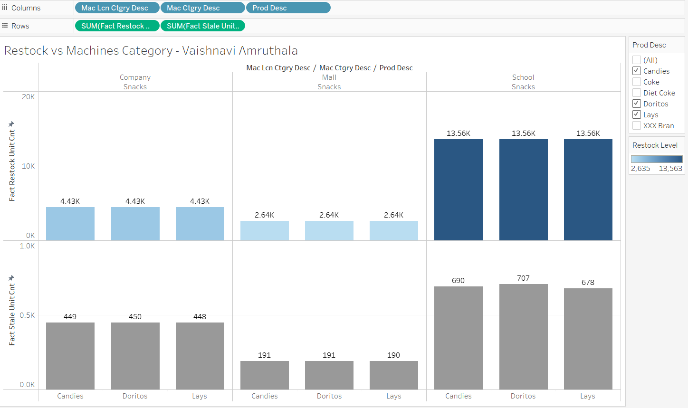
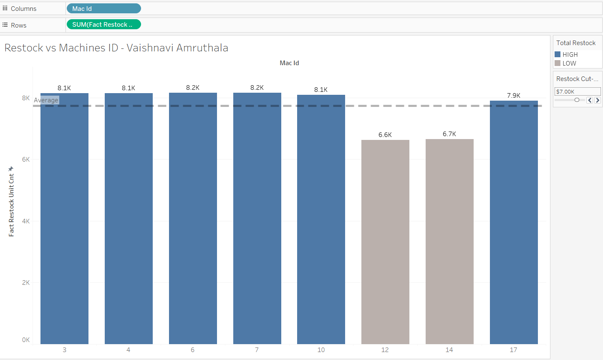
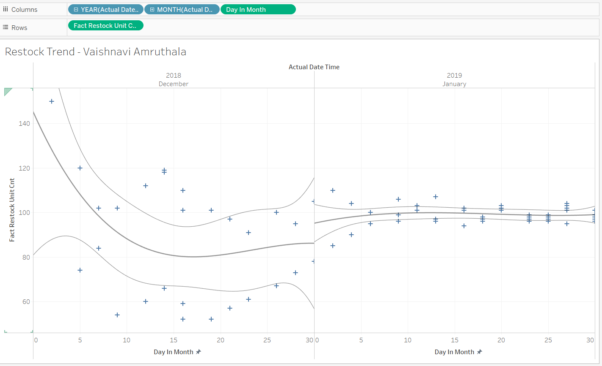
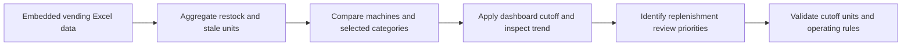

# Inventory Restock & Machine Performance

**Positioning:** Supply Chain Analytics | **Source:** matching `.twbx`, embedded Excel data, and project report

## Executive summary
Analyzed machine restock totals, stale units, and daily restock patterns. In the report’s selected product view (Candies, Doritos, Lays), School Snacks shows the highest restock totals and the highest stale-unit totals, suggesting replenishment should be balanced with staleness review.

## Selected report visuals

## Business question and pipeline
How can restock and stale-unit patterns help operations focus replenishment attention across machines, locations, products, and time?

## Business KPIs

| Metric | Formula / rule | Dashboard value | Interpretation |
|---|---|---:|---|
| Restock units | `SUM([Fact Restock Unit Cnt])` | Company Snacks: **4.43K**; Mall Snacks: **2.64K**; School Snacks: **13.56K** per displayed product | Total units restocked in the selected view. Comparisons use the Candies/Doritos/Lays filter shown in the report. |
| Stale units | `SUM([Fact Stale Unit Cnt])` | Company: **448–450**; Mall: **190–191**; School: **678–707** per displayed product | Units marked stale. Higher values flag stock to investigate; they are not a direct dollar-waste measure. |
| Machine restock | `SUM([Fact Restock Unit Cnt])` by machine ID | IDs 3, 4, 6, 7, 10, 17: **7.9K–8.2K**; IDs 12 and 14: **6.6K–6.7K** | At the displayed cutoff, the first group is colored High and 12/14 Low. The report’s parameter is 7,000; since the measure is units, the `$` shown in the report may be a formatting error. |
| Restock cutoff / High-Low flag | Parameter `Restock Cut-off`; dashboard compares machine restock total with the cutoff | **7,000** default | Read as High at/above the cutoff and Low below it. The report does not expose the exact classifier expression; this is an interpretation of the displayed control, not a confirmed Tableau formula. |
| Daily restock trend | `SUM([Fact Restock Unit Cnt])` by day | December 2018 varies more; January 2019 is clustered near **~95–105 units/day** in the visible chart | Daily pattern helps compare consistency; this short period does not establish a forecast. |

## Model Metrics

No predictive or statistical model is reported; this is a descriptive dashboard. Accuracy, AUC, and prediction error are **not applicable** to the current analysis.

## Insights
- School Snacks has both the highest restock and stale-unit totals in the filtered comparison; high replenishment volume alone does not indicate efficient stock flow.
- Machine IDs 12 and 14 fall below the adjustable 7,000-unit cutoff, while the other displayed machines exceed it.
- January’s visible daily counts are more stable than December’s; the report’s trend prose calls the measure cost, but the Tableau axis is restock unit count.

## Recommendations
1. Review School Snacks replenishment cadence, product shelf life, and demand so high restock is balanced against stale stock.
2. Investigate IDs 12 and 14 against machine capacity, demand, and service history before changing their restock levels.
3. Set and validate the cutoff using demand/stockout history; label it in units, not currency, if that matches the source.
4. Extend the time window before using trends for planning.

## Evidence and proposed structure
- Tableau workbook: [`Inventory-Restock-Machine-Performance.twbx`](workbook/Inventory-Restock-Machine-Performance.twbx)
- Matching source: [`Dataset_Vending_Machines.xlsx`](data/Dataset_Vending_Machines.xlsx), extracted from the packaged workbook.
- Images from the project report: [`assets/`](assets/)
- Proposed repo tree: `README.md`, `assets/`, `workbook/`, `data/`.

The report supports the dashboard scope and operational questions, but not a formal stakeholder map or As-Is workflow. Those are omitted rather than inferred.

## Supporting documents

- [Executive summary](docs/Executive-Summary.md)
- [Business requirements summary](docs/BRD-Summary.md)
- [Functional requirements summary](docs/FRD-Summary.md)

The source reports do not document an existing-state (As-Is) process; none is presented as fact.

