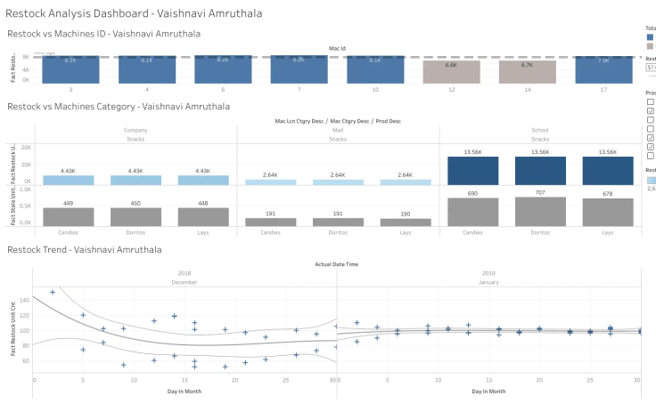
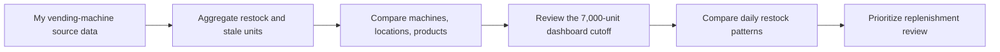

# Inventory Restock & Machine Performance

**My focus:** Supply Chain Analytics

## Executive summary

My analysis reviews machine restock totals, stale units, and daily restock patterns. In the selected product view (Candies, Doritos, and Lays), School Snacks shows the highest restock and stale-unit totals, so Recommended action: reviewing replenishment cadence alongside staleness.

## Business question and pipeline

Business question: where can restock and stale-unit patterns help operations focus replenishment reviews across machines, locations, products, and time?

## Business KPIs

| Metric | Formula / rule | Dashboard value | My interpretation |
|---|---|---:|---|
| Restock units | `SUM([Fact Restock Unit Cnt])` | Company Snacks **4.43K**; Mall Snacks **2.64K**; School Snacks **13.56K** per displayed product | Comparisons cover units restocked in the selected product view. |
| Stale units | `SUM([Fact Stale Unit Cnt])` | Company **448–450**; Mall **190–191**; School **678–707** per displayed product | I treat higher stale-unit totals as a signal to review stock age and demand. |
| Machine restock | `SUM([Fact Restock Unit Cnt])` by machine ID | IDs 3, 4, 6, 7, 10, 17: **7.9K–8.2K**; IDs 12 and 14: **6.6K–6.7K** | Comparisons cover each machine’s restock total against the dashboard cutoff. |
| Restock cutoff | Compare machine restock total with the `Restock Cut-off` parameter | **7,000** default | I read machines at or above the cutoff as High and those below it as Low. |
| Daily restock trend | `SUM([Fact Restock Unit Cnt])` by day | January 2019 is near **95–105 units/day** in the visible chart | My analysis uses the daily view to compare consistency across the displayed period. |

## Model Metrics

The analysis used descriptive comparisons rather than a predictive model, so accuracy, AUC, and prediction error do not apply.

## Insights and recommendations

- The analysis found School Snacks has the highest restock and stale-unit totals in the selected comparison.
- The analysis found machine IDs 12 and 14 below the displayed 7,000-unit cutoff; the other displayed machines are above it.
- Recommended action: reviewing School Snacks replenishment cadence, shelf life, and demand together.
- Recommended action: checking IDs 12 and 14 against machine capacity, demand, and service history before adjusting restock levels.
- Recommended action: using demand and stockout patterns to tune the cutoff and extending the time window for planning.

## Data exploration and visual analysis

Exploration covered restock and stale-unit patterns by product, location, and machine, then reviewed daily changes. Supporting visuals are stored in `data_visualization_and_analysis/`:

- `restock-and-stale-units.png` — compares restock and stale units by machine and product.
- `restock-by-machine.png` — compares machine totals against the displayed cutoff.
- `restock-trend.png` — shows the daily restock pattern.

## Project files

- Tableau workbook: [Inventory-Restock-Machine-Performance.twbx](workbook/Inventory-Restock-Machine-Performance.twbx)
- Source data: [Dataset_Vending_Machines.xlsx](data/Dataset_Vending_Machines.xlsx)

## Supporting documents

- [Executive summary](docs/Executive-Summary.md)
- [Business requirements](docs/BRD-Summary.md)
- [Functional requirements](docs/FRD-Summary.md)
